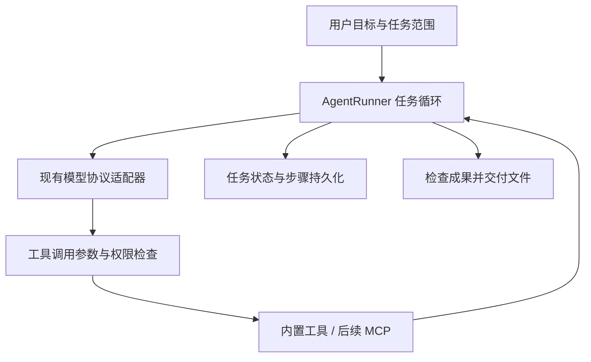

# AI Link 内置 Agent 可行性调研

调研日期：2026-10-30。依据当前仓库代码与公开官方资料；未实现原型，未验证真实模型的工具调用质量、移动端后台续跑或第三方连接器。

## 结论

可行，而且可以继续保持 BYOK、模型直连和本地优先。建议将产品逐步扩展为：**使用用户自己的模型和资料，完成可检查、可中断、可交付任务的个人助手。**

首个场景建议是「资料研究与项目整理」：根据目标自主检索、读取网页和项目资料，必要时补查，交付带来源的报告及可保存的 Markdown/CSV 文件。它能复用现有能力，也能明确展示比单次回答多出来的价值。

首版采用 Dart 内的单 Agent 任务循环，先提供少量内置工具；后续接远程 MCP，再根据真实需求增加桌面执行器。无需先建立自有云端服务，也无需在手机部署本地大模型。模型在哪里推理，与 Agent 在哪里编排和执行工具，是两个独立选择。

这是一项产品与架构建议，不是当前已具备的功能或工期承诺。

## 1. 产品需要增加什么

| 能力 | 用户得到什么 | 与 Agent 的关系 |
| --- | --- | --- |
| 角色/助手配置 | 固定写作风格、专业背景、默认模型 | 改变回答方式，可作为任务模板的一部分 |
| 工具调用 | 查资料、读文件、生成文件、调用应用功能 | 提供可执行动作 |
| MCP | 以统一协议接入外部工具和资料 | 是连接方式；不提供完整任务管理 |
| Agent 任务 | 目标 → 选择动作 → 读取结果 → 调整动作 → 检查交付 | 把模型、工具、权限和任务状态连接起来 |
| 定时自动化 | 到指定条件自动启动任务 | 还需要调度、执行端存活和通知能力 |

应保留直接聊天，同时增加「执行任务」入口。用户可以说「结合项目资料，调查三个方案并保存对比报告」，看到实际读取和执行记录，并拿到真实文件。无需每次手动选择下一步工具。

固定步骤的任务可以使用工作流；需要根据证据补查的任务再交给模型决定步骤。这也符合 Anthropic 对工作流与自主 Agent 的区分，以及从简单实现开始的建议。[官方设计说明](https://www.anthropic.com/research/building-effective-agents)

## 2. 当前仓库基础与缺口

以下以代码为准。`TODO.md` 的部分勾选状态和 `README.md` 的能力描述已有滞后，例如代码已有跨会话记忆与附件流程，不能仅根据文档判断是否实现。

| 当前基础 | 已核对的实现 | Agent 需要补充的内容 |
| --- | --- | --- |
| 两类模型协议 | `lib/api/api_client.dart`，OpenAI 兼容 Chat Completions、Claude Messages、SSE、取消、用量 | 请求工具定义、解析结构化调用、返回工具结果、多轮继续 |
| 联网搜索 | `ModelApiClient.streamReply()` 先对末条用户消息执行一次搜索，再请求模型 | 模型改写查询、多次搜索、按需读取网页正文 |
| 项目资料 | `project_store.dart` 的 `retrieveKnowledge()`、`knowledgeText()` | 受项目权限约束的检索和按需读取工具 |
| 附件 | 私有文件复制、类型识别、图片/PDF 协议发送、UTF-8 读取 | Agent 可访问的附件范围、工具输出文件和成果归档 |
| 跨会话记忆 | `memory_coordinator.dart` 串行总结、事务检查和写回 | 任务工作状态独立保存；保持记忆开关及项目隔离 |
| 本地持久化 | SQLite 聊天、来源、附件元数据；密钥安全存储 | 任务、步骤、授权、执行结果、成果和恢复记录 |
| 多端界面 | 手机共用 Flutter UI、桌面分栏、原生手表 | 任务详情和成果入口、各平台执行能力声明 |

关键限制已经可以定位：

- `streamReply()` 当前返回 `Stream<String>`；`_textFromEvent()` 只提取文字。OpenAI `delta.tool_calls`、Claude `tool_use` 及参数增量没有进入上层流程。只有工具调用、没有文字的合法回复，也可能被当前逻辑视为「无文本」。
- `ChatMessage` 有正文、附件和来源，没有结构化的工具调用、结果及关联 ID；不能只把执行过程拼成聊天文字后期待可靠恢复。
- `ChatContext.select()` 以用户轮次选择文本上下文；Agent 需要保留工具调用和对应结果的完整关系，并预算工具定义与结果占用。
- `MemoryCoordinator` 是资料总结队列，依赖应用进程存活；它不是持久化任务调度器，也不能直接证明后台 Agent 能运行。

现有协议足以起步，不必为了 Agent 强制把全部服务切换到 Responses 或某家托管 Agent API。OpenAI 的官方工具调用文档包含 Chat Completions；Claude Messages 有客户端工具往返机制。具体模型、聚合服务和账号仍需逐一验证支持情况。[OpenAI Function calling](https://developers.openai.com/api/docs/guides/function-calling)、[Claude Tool use](https://platform.claude.com/docs/en/agents-and-tools/tool-use/overview)

## 3. 优先做哪些任务

| 顺序 | 场景示例 | 交付结果 | 判断 |
| --- | --- | --- | --- |
| 第一阶段 | 「调查这三种方案，结合项目需求给出建议」 | 带来源的报告、对比表、Markdown 文件 | 最适合首版；复用搜索和项目资料 |
| 第一阶段 | 「从项目笔记整理需求、分歧和待办」 | 结构化清单、引用的本地资料、可保存草稿 | 能体现项目空间的持续价值 |
| 第二阶段 | 「整理这些文本/CSV，生成汇总文件」 | 真实 CSV、Markdown；格式扩展另行验证 | 先覆盖已支持的文本输入；PDF/Office 解析单独建设 |
| 第二阶段 | 「把结论保存成项目笔记」 | 可检查的新增或修改记录 | 使用应用内部明确的写入接口 |
| 第三阶段 | 「结合日历、邮件和知识库安排工作」 | 汇总、草稿、经授权的外部操作 | 需要连接器、OAuth、权限与失败恢复 |
| 后续评估 | 「在我的电脑上处理目录、运行代码」 | 文件、执行日志、运行结果 | 需要桌面执行器和隔离环境 |
| 后续评估 | 「每天自动监测并通知我」 | 定时结果和通知 | 需要可靠在线的调度与执行端 |

建议先用一个 Agent 配几种任务模板。模板可包含目标说明、可用工具、默认模型、成果格式和预算；目前没有证据表明第一阶段需要多个 Agent 协作。

RikkaHub 当前公开 README 已列出 PRoot Linux 工作区、MCP、Skills、Agent 自定义与文件记忆，说明相邻产品正在扩大执行能力；这只是项目公开声明，本次没有运行验收其功能。AI Link 可以先突出「多模型自选 + 项目资料 + 手机/桌面任务体验」，再判断是否值得建设 Linux 工作区。[RikkaHub](https://github.com/rikkahub/rikkahub#-features)

## 4. 技术路线选择

| 路线 | 适用性 | 成本与边界 | 建议 |
| --- | --- | --- | --- |
| Flutter/Dart 内实现任务循环 | 手机和桌面共用编排，直接复用当前服务配置 | 自己维护协议事件、任务状态和权限；无需新语言运行时 | 首版采用 |
| 接入远程 MCP | 连接独立部署的服务工具 | 仍需 Agent 循环；增加协议版本、认证、重连与工具信任管理 | 内置工具稳定后加入 |
| 嵌入现成 Agent SDK/CLI 进程 | 桌面或远程执行器 | 增加运行时分发、进程管理、平台适配和供应商耦合 | 作为可选执行后端评估 |
| 自有云端任务服务 | 长任务、定时任务、离线后继续执行 | 引入账户、托管、密钥或委托认证、数据流与持续运营成本 | 有需求证据后再做 |

Claude Agent SDK 当前提供 Python、TypeScript 接口，并运行 Claude Code 二进制；它可作为桌面/服务器执行引擎的候选，但不是可以直接放进 Flutter、自然覆盖 iOS 与 Android 的组件。这里对 AI Link 的适配判断是工程推断。[Agent SDK overview](https://code.claude.com/docs/en/agent-sdk/overview)

MCP 官方 SDK 清单本次未列出 Dart。社区 Dart 包仍可评估，但采用前需要核对协议版本、移动端可用性、维护和许可，不能视为已经验证的依赖。[官方 SDK 清单](https://modelcontextprotocol.io/docs/2026-07-28/sdk)

建议将工具执行接口独立出来，使内置 Dart 工具、远程 MCP、未来桌面执行器都实现同一层抽象。MCP 接入不会替代权限和任务状态设计。

## 5. 最小架构

建议按项目的功能域约定新增 `lib/agent/`，由它持有任务编排；`api/` 负责协议，`core/` 只放确需跨功能共享的数据基础设施。不要把任务循环继续堆进 `ChatHome`。

### 模型事件和上下文

- 在文本流之外增加结构化事件：文字增量、工具调用增量、完整调用、用量、回合结束及停止原因。保留原普通聊天入口的适配层。
- OpenAI 按调用索引/ID 合并流式参数；Claude 按内容块索引合并输入 JSON。只有参数完整、校验成功且回合状态允许时才执行。
- 记录调用 ID 与结果的对应关系；Claude 的内容块、OpenAI 的工具消息分别按原协议重建。适用时保留协议要求回传的签名或不透明字段。
- 工具错误以受控结果返回模型，让它决定补救；不支持工具的服务保留普通聊天能力，不把模型输出的任意文本当命令执行。
- 首版按同一服务/模型完成一项任务，避免中途切换导致不透明协议状态和上下文不兼容。
- 上下文预算覆盖系统提示词、工具 schema、调用参数、工具结果、附件及输出预留；压缩旧步骤时保留有效证据和未完成调用关系。任务工作笔记与用户长期记忆分别管理。

工具结果按需检索和逐步读入，有助于控制长任务上下文；不应把所有项目文档和所有 MCP 工具一次性注入。[上下文工程说明](https://www.anthropic.com/research/effective-context-engineering-for-ai-agents)

### 任务状态和恢复

任务状态至少覆盖：待执行、执行中、等待用户、暂停/中断、完成、失败、取消。工具步骤单独记录调用准备、执行中、已返回和结果不确定。

SQLite 可新增任务、步骤和成果记录，关联会话及项目；保存目标、所用服务/模型、授权范围、预算、完整调用关系和成果元数据。字段与迁移在实施阶段定稿，保持可重复迁移，不触碰旧聊天数据。

- 每次调用前保存意图，返回后保存结果；应用结束后能区分已完成与未确认的动作。
- 恢复只重放本地状态；外部动作是否重试由工具能力决定。写入接口优先使用幂等键或远端状态查询。
- 遇到「请求已发出、响应未收到」时，可能无法知道操作是否成功。应显示结果不确定并核验，不能靠自动重发声称实现恰好一次执行。
- 取消会终止后续步骤并尽力关闭当前请求；已经提交的外部操作不能保证撤回。
- 设置模型回合数、工具调用数、总时长、输出大小和 Token 预算。没有完整价格和用量数据时，展示粗估费用及不确定性，不能承诺精确金额封顶。

## 6. 第一版工具范围

| 工具 | 复用/新增 | 执行边界 |
| --- | --- | --- |
| `search_web` | 复用 `SearchClient` | 使用用户配置的搜索服务，受数量和调用预算限制 |
| `read_webpage` | 新增 | 读取正文，限制协议、响应大小、时间、跳转和目标地址 |
| `search_project` | 复用 `retrieveKnowledge()` | 仅访问任务授权的项目 |
| `read_project_document` | 包装 `knowledgeText()` | 按文档 ID 再核对项目归属，分段读取并限制输出 |
| `read_task_attachment` | 包装现有附件存储 | 仅访问本次选入或已授权的附件；首版限可解析文本 |
| `save_artifact` | 新增 | 在任务私有目录生成 Markdown/CSV 文件，再提供预览、保存和分享 |

这些名称是设计建议，当前均未作为 Agent 工具实现。`knowledgeText(id)` 本身不能代表完整授权检查，工具层必须约束文档归属。

第一版网页读取先覆盖公开网页正文，说明无法处理的登录、复杂交互和动态页面；需要外部抓取服务时独立配置其凭据及数据去向。不能把搜索摘要呈现成已经阅读全文。

网页读取要在连接和每次跳转时检查目标，防止利用公网 URL 访问内网或本机服务。用户主动配置的私有连接器使用独立授权路径。正文、文件名、工具返回和工具说明均视为外部输入，不能扩大任务权限。

工具声明至少包含输入 schema、输出限制、数据去向、所需权限、是否有副作用、超时、重试及幂等特征。权限由执行器校验，不能仅依赖提示词；MCP 的声明也不能直接作为可信授权依据。[MCP 安全实践](https://modelcontextprotocol.io/docs/2026-07-28/tutorials/security/security_best_practices)

权限体验以任务为单位：已授权的公开检索、项目读取和新建成果自动连续执行；需要扩大资料范围、覆盖文件或新增外部写入时再展示具体操作。用户明确要求并已授权的动作不应每一步重复确认。

密钥留在安全存储，由对应适配器注入；不作为模型工具参数或普通工具结果。调用参数和结果也可能含私人资料，执行日志需限定保存范围、脱敏并支持删除。

## 7. 多端执行边界

| 平台 | 适合承担的任务 | 需要明确的限制 |
| --- | --- | --- |
| Android | 前台工具循环、项目资料、系统允许时的普通后台执行 | 不使用前台服务保活；系统挂起时随进程挂起，回收后从已保存检查点手动继续；Flutter isolate 不等于系统授予运行时间 |
| iOS/iPadOS | 前台短任务、系统允许的后台续跑、原生能力连接 | 根据系统版本适配，不能承诺长期驻留或准确时刻唤醒 |
| macOS/Windows/Linux | 公共任务引擎、授权目录、可选本地执行器 | 应用退出、系统休眠和权限撤销仍会中断；常驻服务需要独立设计与安装 |
| Wear OS/Apple Watch | 简短任务入口、查看状态和结果 | 首版可保持现有问答；后续若增加任务入口，应交给已授权执行端处理 |

iOS 的常规后台策略由系统管理，运行时间受限。iOS/iPadOS 26 新增 `BGContinuedProcessingTask`，可继续用户前台发起的工作并展示系统进度，但需要处理取消、资源限制和提前结束。它值得原型验证，不能理解为通用守护进程。[Apple 后台策略](https://developer.apple.com/documentation/backgroundtasks/choosing-background-strategies-for-your-app)、[WWDC25 后台任务说明](https://developer.apple.com/videos/play/wwdc2025/227/)

Android 官方提供持久化和长任务执行机制，并要求按情形处理前台通知及服务类型；它们也需要原生生命周期集成。[Task scheduling](https://developer.android.com/develop/background-work/background-tasks/persistent)、[Long-running workers](https://developer.android.com/develop/background-work/background-tasks/persistent/how-to/long-running)

直接在 iOS 内引入通用下载代码、脚本插件或 Linux 执行环境，还涉及 App Review 2.5.2、2.5.4 等约束。对具体方案的影响需要结合实现和分发方式另行评估；不能由此推断所有解释器或所有 Agent 都被禁止。[App Review Guidelines](https://developer.apple.com/app-store/review/guidelines/#software-requirements)

手机访问远程 MCP 可优先采用 Streamable HTTP；桌面再评估启动本地 stdio 服务。stdio 涉及客户端启动子进程，两者的分发和权限成本不同。协议版本需在实施时明确选择，并测试协商及兼容；本次读取的最新规范解析到 2026-07-28，不宜只按旧版初始化/会话假设实现。[MCP transports](https://modelcontextprotocol.io/specification/2026-07-28/basic/transports)

「手机发起、桌面继续」需要新增配对、认证、执行端发现、任务传输和结果同步；当前手机/桌面独立本地存储与手表配对链路不等于已有这项能力。首版不以它为前提。

## 8. 页面与交付体验

保留现有聊天与项目导航；在输入区附近增加「聊天 / 执行任务」选择，首版提供研究、项目整理两种模板，配置集中放在模型设置的 Agent 子页。

任务页优先显示目标、当前动作、已用时间、预算和成果。步骤按「检索了什么、读取了哪些资料、哪些操作成功或失败」展开；展示可观察记录与必要的计划摘要，不展示内部思维链，也不把模型写出的计划当作已执行证据。

成果提供真实文件预览及打开、保存、分享入口。仅有正文时写明正文交付，不能显示不存在的「文件已生成」。允许用户补充要求、取消，以及从明确状态继续中断任务。

手机使用现有 iOS 风格组件，桌面在详情区域显示任务，保留会话侧栏。多语言、深色模式、附件清理和删除任务后的成果保留策略需要一并设计。

## 9. 分阶段落地与验收

### 阶段 A：验证闭环

固定一个已验证支持工具调用的模型，接入项目检索、搜索及文件生成，完成「目标 → 工具调用 → 结果 → 再次调用 → 成果」闭环。此阶段重点测工具选择和参数质量，使用真实服务；本地模拟协议测试不能替代它。

关键结果：用户给出真实任务后，能看到实际来源和真实文件，并能在预算内结束。先不增加 MCP、代码执行、定时调度或多个 Agent。

### 阶段 B：可用的内置 Agent 首版

补齐两类协议、持久化状态、进度、取消、失败恢复、工具权限、成果预览和三语文案。手机以前台任务为可靠基线，桌面共用任务引擎。

建议准备至少 20 个固定验收任务，包含多轮补查、长网页、空结果、资料冲突、跨项目访问、恶意网页指令、参数截断、重复调用、取消和重启。记录任务完成率、来源可追溯性、结果正确性、用量、耗时及人工干预次数；实际目标阈值根据阶段 A 的基线确定。

必须覆盖的确定性行为：

- 合法的纯工具回复不会报「无文本」；参数未完整时不执行。
- 超出授权项目或附件范围的调用被执行器拒绝。
- 达到预算、超时或取消后不再安排新动作。
- 恢复不重复提交已完成写入；外部结果不确定时保持可核验状态。
- 输出文件存在且能重新打开；来源来自实际检索或读取记录。
- API Key 不进入模型工具上下文、普通 SQLite 字段或错误展示。
- 原聊天、重试、项目隔离和用户已有记忆设置通过回归检查。

UI 改动后按项目约定检查 Android 截图、长内容、键盘及返回路径；iOS、Windows 和后台续跑分别记录构建与设备证据。

### 阶段 C：连接服务

先接一种真实有价值的远程 MCP 服务，完成认证、发现、工具筛选、数据去向展示及断线处理，再决定是否扩展连接器目录。发邮件、改日历等写入能力需要明确结果预览、授权范围和重复提交处理。

### 阶段 D：执行器与自动化

根据用户任务数据，选择桌面受限目录/代码沙箱、自托管执行器或云端服务。定时任务和 App 关闭后的持续执行依赖这一阶段的可靠运行环境。远端方案另行定义凭据、数据保留、成本和通知策略。

不建议在本次桌面调研基础上给固定工期。可先将阶段 A 拆成协议事件、任务循环、三个工具和成果验收，再以原型结果估算首版成本。

## 10. 尚待验证的问题

- 哪些常用服务和模型能稳定完成中文工具调用，包括流式参数、严格 schema 和多轮结果处理？
- 现有搜索服务在连续调用下的质量、费用和限流如何？公开网页正文提取需要覆盖哪些网站？
- iOS 后台续跑 API 对网络等待较多的多轮任务是否合适，各支持系统版本如何降级？
- 用户更看重资料报告、项目整理，还是应用操作？这是首版上线后应采集的产品证据。
- 最合适的 MCP Dart 实现、协议兼容范围及许可尚未选定；第三方认证方式和商店审核结果未验证。
- 长期运行是否值得引入执行服务器，以及用户是否愿意托管密钥或维护自己的执行端？

复查输入：当前仓库 `api_client.dart`、`project_store.dart`、`data.dart`、`chat_context.dart`、`memory_coordinator.dart`；上述官方工具协议、MCP、移动端后台与 SDK 文档。实施时重新核对版本和真实服务表现。
